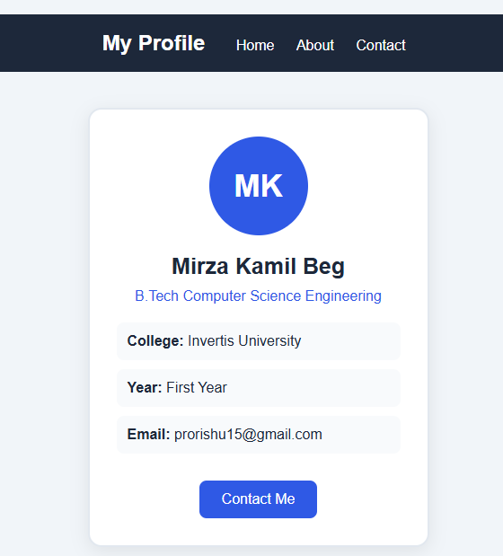

# Mirza Kamil Beg — Profile Card Project

A simple and responsive personal profile card website created using **HTML and CSS** as part of the Web Development assignment.

## About the Project

This project displays a personal profile card containing basic student information, including name, college, degree, year, and email address.

The main purpose of this project is to understand the fundamentals of CSS, especially the **Box Model, Display Properties, and Positioning**.

## Student Details

- **Name:** Mirza Kamil Beg
- **Email:** prorishu15@gmail.com
- **College:** Invertis University
- **Degree:** B.Tech in Computer Science Engineering
- **Year:** First Year


## Technologies Used

- HTML5
- CSS3

## Concepts Covered

This project demonstrates the following CSS concepts:

1. **Box Model:** Margin, padding, border, and content.
2. **Display:** Block, inline-block, and flex.
3. **Positioning:** Relative and fixed positioning.
4. **Border Radius:** Creating rounded elements.
5. **Hover Effects:** Interactive button styling.
6. **Responsive Design:** Using CSS media queries.
7. **Box Sizing:** Using `box-sizing: border-box`.

## Project Structure

```text
profile-card/
│
└── index.html
```

## Screenshots


## How to Run the Project

1. Download or clone this repository.
2. Open the project folder in VS Code.
3. Open the `index.html` file.
4. Right-click and select **Open with Live Server**.

You can also open `index.html` directly in any web browser.

## Contact

**Mirza Kamil Beg**

Email: prorishu15@gmail.com

---
